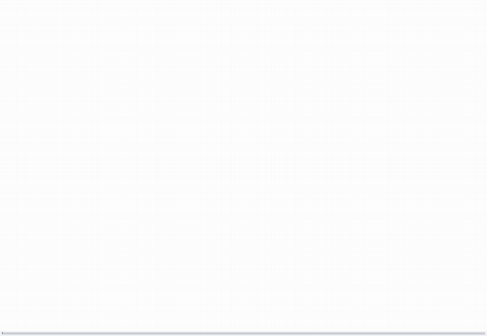
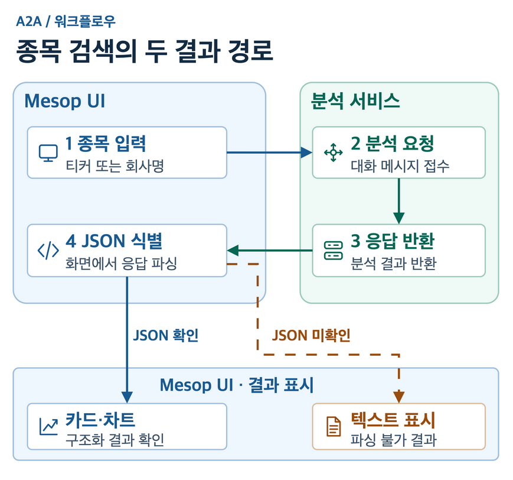
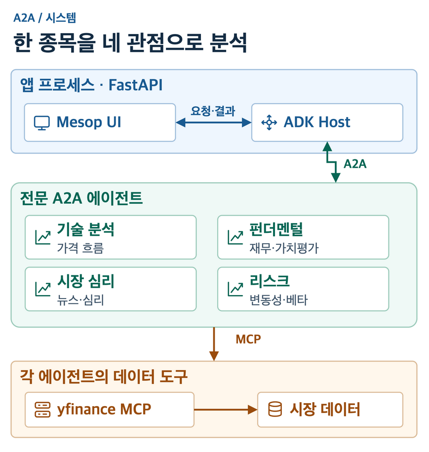
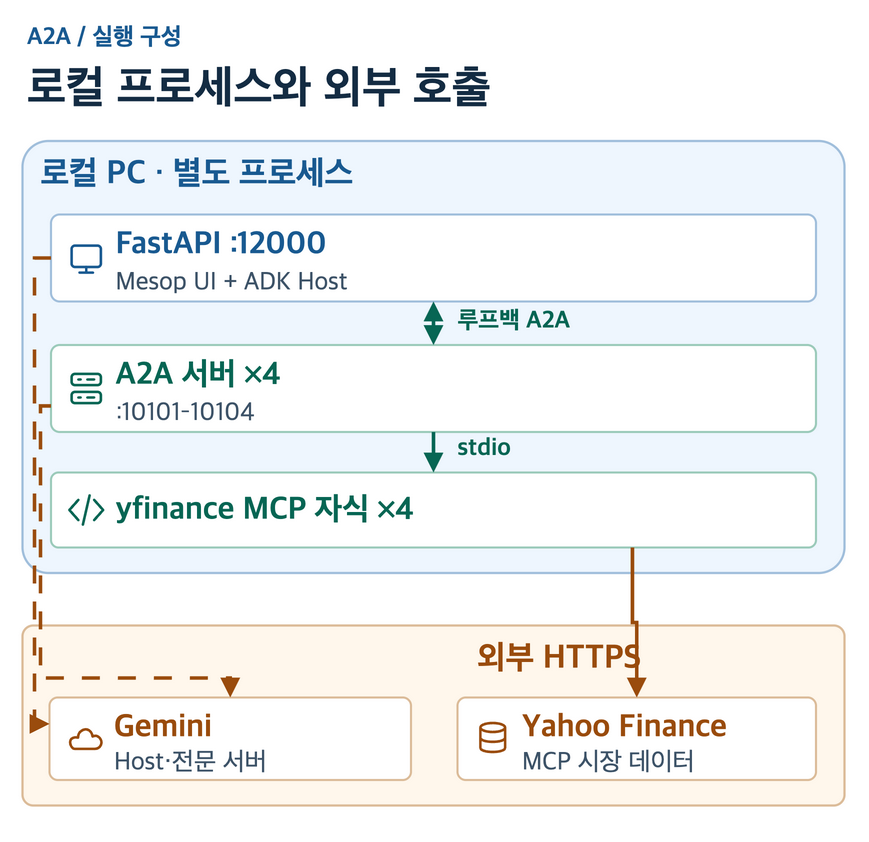

# A2A 주식 분석 에이전트 | 수업 프로젝트

종목 하나를 입력하면 기술적 분석, 재무, 시장 심리, 리스크를 담당하는 에이전트에 각각 요청하고, 그 결과를 한 화면에서 비교할 수 있는 과제 프로젝트입니다. A2A Samples의 대화 UI와 에이전트 연결 구조를 바탕으로, 주식 분석 역할·데이터 도구·결과 화면을 구현했습니다.

## 문제 정의와 담당 범위

같은 기업도 가격 흐름, 재무 상태, 시장 여론, 변동성을 보는 기준이 서로 다릅니다. 역할마다 조회할 도구와 출력 형식을 정하고, 한 번의 종목 검색에서 네 분석을 비교할 수 있게 구성했습니다.

| 구분 | 내용 |
| --- | --- |
| 구현 범위 | 분석 에이전트 4종, 시장 데이터 도구 연결, Host 호출 및 오류 처리, 종목 분석 대시보드 |
| 기술 | Python, Google ADK, A2A SDK, yfinance MCP, Mesop, Plotly |
| 기반 코드 | [A2A Samples](https://github.com/a2aproject/a2a-samples)의 Mesop 데모와 Host/Remote Agent 통신 구조를 활용 |

## 대표 시연



검색창에 AVGO를 입력하고 **분석**을 누릅니다. 요약이 나타나면 아래로 내려 기술적 분석·펀더멘털 차트를 먼저 보고, 시장 심리·리스크 카드까지 확인합니다. (저장 응답 재생)

## 주요 기능과 사용자 흐름



1. 한 종목을 검색하면 대시보드에서 분야별 진행 상태를 보여줍니다.
2. 결과가 나오면 기술적 분석에서 가격과 지지·저항 수준을 비교하고, 펀더멘털에서 가치평가 지표를 봅니다.
3. 이어서 시장 심리 점수와 변동성 지표를 확인합니다. 카드로 바꿀 수 없는 응답은 텍스트로 남겨 내용을 읽을 수 있습니다.

## 아키텍처



| 구성요소 | 책임 |
| --- | --- |
| Mesop UI | 대화 생성, 종목 검색, 진행 확인, 분석 JSON을 카드와 차트로 표시 |
| ADK Host | AgentCard로 에이전트 등록, 요청 분배, 응답 수집 |
| A2A 에이전트 4종 | 분석 기준에 맞는 데이터 호출, 결과 작성 |
| yfinance MCP | 시세·재무·뉴스 등 분석에 필요한 시장 데이터 조회 |



편집용 원본: [시스템](docs/portfolio-readme/diagrams/system.drawio) · [요청 흐름](docs/portfolio-readme/diagrams/runtime.drawio) · [사용자 흐름](docs/portfolio-readme/diagrams/workflow.drawio)

## 기술적 의사결정과 문제 해결

### 데이터 조회를 분석 에이전트에 배치

도구를 Host에 중앙화했을 때 분석 에이전트에서는 도구를 잃었고 Host도 데이터를 조회하지 않아 분석에 필요한 입력이 비었습니다. 각 분석 에이전트에 도구를 다시 연결했습니다. 역할에 맞는 데이터를 필요한 시점에 요청할 수 있지만, 여러 에이전트가 같은 종목 데이터를 중복 조회할 수 있습니다.

### 병렬 호출에 실패 처리 추가

네 분석은 서로의 답을 기다릴 필요가 없습니다. 초기 병렬 시도에서는 요청 제한(429) 때문에 순차 흐름으로 되돌렸습니다. 제출본은 asyncio.gather로 병렬 호출을 다시 구성하고, 재시도와 실패 응답을 다룹니다. 제공자 한도가 낮은 환경에서는 네 호출을 한꺼번에 보내기보다 동시 실행 수를 제한하는 편이 좋습니다.

### 구조화된 분석 결과를 UI 계약으로 사용

자연어만 받으면 숫자·범주를 안정적으로 뽑아 카드와 차트를 만들기 어렵습니다. 분야별 JSON을 파싱해 화면을 구성하고, 구조화되지 않은 응답은 텍스트로 표시합니다. A2A의 Task와 Artifact는 전송 계층이고, 분석 JSON은 UI가 해석하는 데이터입니다. 모델이 형식을 지키지 않아도 답변을 잃지는 않지만, 그 답변에 대해서는 카드와 차트를 표시할 수 없습니다.

## 실행 및 검증

위의 구현 브랜치에서 실행합니다. Google AI Studio API 키와 시장 데이터 접근이 필요합니다. GOOGLE_API_KEY는 환경변수로만 제공합니다.

```bash
uv sync --python 3.13 --locked --all-packages

# 아래 에이전트와 UI를 각각 별도 터미널에서 실행
(cd agents/technical_analyst   && uv run uvicorn agent:a2a_app --host 127.0.0.1 --port 10101)
(cd agents/fundamental_analyst && uv run uvicorn agent:a2a_app --host 127.0.0.1 --port 10102)
(cd agents/sentiment_analyst   && uv run uvicorn agent:a2a_app --host 127.0.0.1 --port 10103)
(cd agents/risk_assessor       && uv run uvicorn agent:a2a_app --host 127.0.0.1 --port 10104)
(cd demo/ui && A2A_UI_HOST=127.0.0.1 A2A_UI_PORT=12000 uv run main.py)
```

브라우저에서 http://127.0.0.1:12000/conversation 을 엽니다.

[A2A 통신 검증 기록](docs/portfolio-readme/verification.md)
