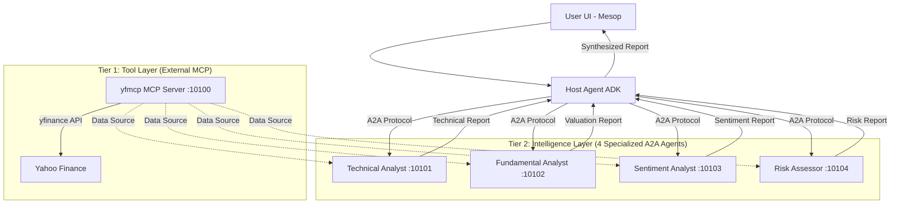

# 🏛️ AI Stock Analysis Agent Architecture

This document outlines the business logic, agent roles, and data flow for the Stock Analysis Agent. It combines **A2A (Agent-to-Agent)** for expert reasoning and **MCP (Model Context Protocol)** for real-time data fetching.

## 1. Project Overview
*   **Goal:** Automate the process of gathering scattered stock data, comparing it with peers, and generating a comprehensive investment report.
*   **Key Value Proposition:**
    *   **Automation:** Fetches financials, news, and competitor data in one go.
    *   **Insight:** Provides judgments based on market sentiment (VIX) and analyst consensus, not just raw numbers.
    *   **Scalability:** Designed to easily add technical analysis (RSI) later.

## 2. High-Level Architecture (3-Tier)



**Key Components:**
- **UI (Mesop)**: Web interface for user interaction
- **Host Agent (ADK)**: Orchestrator using Google ADK
  - Automatically registers 4 specialized agents from `agents.json`
  - Uses **A2A Client** to delegate tasks in parallel
  - Synthesizes responses into comprehensive report
- **MCP Server (External)**: Existing yfinance-mcp server for data fetching
  - Provides data to agents when they need it
  - Not directly connected to Host Agent
- **4 Specialized A2A Agents**: Each focused on specific analysis domain
  - Technical Analyst: Chart patterns, indicators
  - Fundamental Analyst: Financials, valuation
  - Sentiment Analyst: News, market sentiment
  - Risk Assessor: Volatility, risk metrics

## 3. Agent Roles & Responsibilities

### A. Host Agent (The Orchestrator)
*   **Technology:** Google ADK (Agent Development Kit)
*   **Role:** Coordinates between user requests, MCP tools, and remote agents. Like a project manager who knows which specialist to consult.
*   **Key Capabilities:**
    1.  **Tool Management:** Dynamically loads MCP tools via `MCPToolset.from_server()`
    2.  **Agent Delegation:** Routes complex analysis tasks to specialized A2A agents
    3.  **Response Aggregation:** Combines data from multiple sources into coherent responses

*   **Workflow:**
    1.  Receives user input (e.g., "Should I invest in Apple stock?")
    2.  Identifies stock ticker (AAPL)
    3.  Delegates analysis to **4 specialized agents in parallel** via A2A:
        - Technical Analyst: Price trends, indicators
        - Fundamental Analyst: Financial health, valuation
        - Sentiment Analyst: News, market mood
        - Risk Assessor: Volatility, risk profile
    4.  Collects all 4 reports
    5.  Synthesizes comprehensive investment recommendation
    6.  Delivers unified report to user via UI

*   **Implementation:** `hosts/multiagent/host_agent.py`
    ```python
    # Auto-loads agents from agents.json on startup
    # Uses existing A2A delegation mechanism
    remote_agent_connections = RemoteAgentConnections(...)

    # Enhanced instruction for multi-agent coordination
    def root_instruction(self, context):
        return """You are a financial analyst coordinating 4 specialists:
        - Technical Analyst, Fundamental Analyst, Sentiment Analyst, Risk Assessor
        Delegate to all agents, then synthesize their insights."""
    ```

---

### B. External MCP Server (The Data Provider)
*   **Technology:** Existing open-source MCP server (we use **yfmcp** or **yahoo-finance-mcp**)
*   **Role:** Provides stock market data through standardized MCP tools

*   **Available Tools (from yfmcp):**
    1.  `get_stock_info(ticker: str)` → Company profile, market cap, PE ratio, etc.
    2.  `get_historical_data(ticker: str, period: str, interval: str)` → Price history
    3.  `get_analyst_recommendations(ticker: str)` → Buy/Hold/Sell ratings
    4.  `get_news(ticker: str)` → Recent news articles
    5.  `get_financials(ticker: str)` → Income statement, balance sheet

*   **Example Output:**
    ```json
    {
      "symbol": "AAPL",
      "currentPrice": 150.25,
      "marketCap": 2500000000000,
      "peRatio": 28.5,
      "targetMeanPrice": 175.0,
      "recommendationKey": "buy"
    }
    ```

*   **Why External?** We don't reinvent the wheel. Community-maintained MCP servers are:
    - Battle-tested and reliable
    - Regularly updated with new features
    - Support multiple data sources

---

### C. Specialized A2A Agents (The Expert Team)

We deploy **4 independent A2A agents**, each with focused expertise:

#### **C1. Technical Analyst Agent** (Port 10101)
*   **Persona:** "Professional chart analyst with expertise in technical indicators"
*   **Expertise:** Chart patterns, RSI, MACD, Moving Averages, support/resistance levels
*   **Output:** Technical outlook (Bullish/Bearish/Neutral), entry/exit points, confidence level

#### **C2. Fundamental Analyst Agent** (Port 10102)
*   **Persona:** "CFA-certified fundamental analyst"
*   **Expertise:** P/E ratios, earnings growth, ROE, financial health, valuation metrics
*   **Output:** Valuation assessment (Undervalued/Overvalued), fair value estimate, recommendation

#### **C3. Sentiment Analyst Agent** (Port 10103)
*   **Persona:** "Market sentiment expert tracking news and analyst ratings"
*   **Expertise:** News analysis, analyst consensus, price targets, market mood
*   **Output:** Sentiment score (Positive/Negative/Neutral), key catalysts, consensus ratings

#### **C4. Risk Assessor Agent** (Port 10104)
*   **Persona:** "Quantitative risk analyst"
*   **Expertise:** Volatility metrics, VIX context, beta, maximum drawdown, risk-adjusted returns
*   **Output:** Risk level (Low/Moderate/High), portfolio fit, position sizing recommendations

*   **Combined Output Format (synthesized by Host):**
    ```
    📊 COMPREHENSIVE ANALYSIS: Apple Inc. (AAPL)

    TECHNICAL OUTLOOK (Technical Analyst): 📈 Bullish
    - RSI: 65 (not overbought), MACD: Bullish crossover
    - Support: $145, Resistance: $160
    - Recommendation: BUY on pullback to $148

    VALUATION (Fundamental Analyst): ⚖️ Fairly Valued
    - P/E: 28.5x vs sector 25x (slight premium justified by growth)
    - ROE: 147%, Revenue growth: +8% YoY
    - Fair value: $155 (current: $150)

    SENTIMENT (Sentiment Analyst): 📊 Positive
    - 75% of analysts rate BUY, avg target: $165
    - Recent news: AI product launch (positive)
    - Institutional buying increased

    RISK ASSESSMENT (Risk Assessor): ⚠️ Moderate
    - Beta: 1.2, Volatility: 22% annualized
    - Max drawdown: -32% (2022), recovered in 8 months
    - VIX: 15 (market calm)

    FINAL RECOMMENDATION: BUY
    Target allocation: 5-8% of portfolio
    Entry: $145-150, Stop-loss: $138, Target: $165
    ```

*   **Implementation:** `agents/{specialist}/agent.py`
    ```python
    Agent(
        model=LiteLlm(model='gemini/gemini-2.0-flash-001'),
        name='[Technical/Fundamental/Sentiment/Risk] Analyst',
        description='Expert in [domain]',
        instruction="""[Detailed analysis framework]"""
    )

    # Each runs on separate port (10101-10104)
    server = A2aServer(agent)
    server.run(port=1010X)
    ```

## 4. Data Flow Scenario

### **Example: User asks "Should I invest in Apple stock?"**

#### **Step-by-Step Execution:**

1. **User → UI (Mesop)**
   ```
   User types: "Should I invest in Apple stock?"
   UI sends request to Host Agent
   ```

2. **Host Agent → MCP Server (Data Collection)**
   ```python
   # Host Agent uses MCP tools
   stock_info = await mcp_tools.get_stock_info("AAPL")
   news = await mcp_tools.get_news("AAPL")
   recommendations = await mcp_tools.get_analyst_recommendations("AAPL")
   ```

   **MCP Response:**
   ```json
   {
     "symbol": "AAPL",
     "currentPrice": 150.25,
     "peRatio": 28.5,
     "targetMeanPrice": 175.0,
     "recommendationKey": "buy",
     "news": [
       "Apple announces new AI features...",
       "Supply chain concerns in Asia..."
     ]
   }
   ```

3. **Host Agent → Stock Analyst (A2A Protocol)**
   ```python
   # Host Agent delegates to remote agent
   analysis = await send_message(
       agent_name="Stock Analyst",
       message=f"Analyze this stock data: {stock_info}"
   )
   ```

4. **Stock Analyst Agent → Analysis**
   - Evaluates PE ratio vs. sector
   - Interprets analyst consensus
   - Assesses news sentiment
   - Generates recommendation

   **A2A Response:**
   ```
   📊 APPLE INC. (AAPL) - INVESTMENT ANALYSIS

   VALUATION: Fairly valued at 28.5x PE
   SENTIMENT: Bullish - 16% upside to target
   RISKS: Supply chain, market volatility

   RECOMMENDATION: BUY with $145 entry point
   ```

5. **Host Agent → UI**
   - Combines MCP data + Analyst insights
   - Formats for user-friendly display

6. **UI → User**
   - Displays comprehensive report
   - Shows data sources and timestamps

---

### **Sequence Diagram:**

```
User          UI          Host Agent      MCP Server      Stock Analyst
 |            |                |               |                |
 |--Request-->|                |               |                |
 |            |--"Analyze AAPL"|               |                |
 |            |                |--get_stock_info("AAPL")------->|
 |            |                |<-{price: 150, pe: 28.5, ...}---|
 |            |                |                                 |
 |            |                |--A2A: "Analyze this data"------>|
 |            |                |<--"BUY recommendation......"-----|
 |            |<--Final Report-|                                 |
 |<--Display--|                |                                 |
```

---

## 5. Development Roadmap

### **Phase 1: MVP (Core Features)** 🎯
*   [x] Research existing MCP servers for stock data
*   [ ] Copy `a2a-samples-main/demo` to project
*   [ ] Setup `uv` workspace with proper structure
*   [ ] Modify Host Agent to connect to yfmcp MCP server
*   [ ] Create Stock Analyst A2A remote agent
*   [ ] Test end-to-end flow (UI → Host → MCP + A2A → UI)

### **Phase 2: Intelligence Enhancement** 🧠
*   [ ] Tune Stock Analyst prompts for better expertise
*   [ ] Add peer comparison agent (e.g., "Compare AAPL vs. MSFT")
*   [ ] Implement portfolio analysis (multiple stocks)
*   [ ] Add chart generation from historical data

### **Phase 3: Advanced Features** 🚀
*   [ ] **Technical Analysis Agent:**
    - Connect to technical indicators MCP (RSI, MACD, Moving Averages)
    - Pattern recognition (Head & Shoulders, Support/Resistance)
*   [ ] **News Sentiment Agent:**
    - Deep analysis of news articles (not just headlines)
    - Sentiment scoring using LLM
*   [ ] **Risk Assessment Agent:**
    - Portfolio diversification analysis
    - VaR (Value at Risk) calculations

### **Phase 4: Production Deployment** 🌐
*   [ ] Deploy to Google Cloud Run
*   [ ] Add user authentication
*   [ ] Implement rate limiting and caching
*   [ ] Set up monitoring and logging
*   [ ] Create API documentation

---

## 6. Why This Architecture?

### **Separation of Concerns:**
- **MCP (Tools)**: Data fetching - standardized, reusable, community-maintained
- **A2A (Agents)**: Intelligence - domain expertise, reasoning, interpretation
- **Host Agent**: Orchestration - knows when to use tools vs. delegate to experts

### **Scalability:**
- Add new MCP servers (e.g., crypto data, commodities) without changing agents
- Add new specialist agents (e.g., options trader, portfolio manager) without changing tools
- Host Agent automatically discovers new capabilities

### **Maintainability:**
- Use battle-tested MCP servers instead of custom API wrappers
- Minimal modifications to demo codebase (~20 lines in host_agent.py)
- Clear separation between data layer and intelligence layer

---

## 7. Example Use Cases

### **Basic Analysis:**
- "What's the current price of Tesla?"
- "Should I buy Apple stock?"

### **Comparative Analysis:**
- "Compare Google vs. Microsoft for long-term investment"
- "Which semiconductor stock is better: NVDA or AMD?"

### **Advanced Queries:**
- "Analyze my portfolio: 50% AAPL, 30% MSFT, 20% GOOGL"
- "Find undervalued tech stocks with PE < 20"
- "What are the risks of investing in Chinese stocks?"

Each query leverages:
1. **MCP tools** for real-time data
2. **Stock Analyst agent** for expert interpretation
3. **Host Agent** for orchestration
